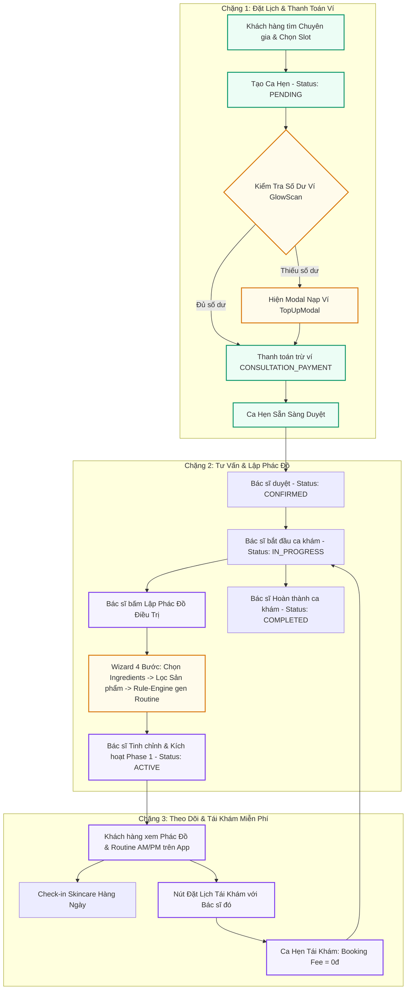

# 🗺️ QUY TRÌNH TƯ VẤN & PHÁC ĐỒ ĐIỀU TRỊ - KẾ HOẠCH FRONTEND (FE-PLANNING)

Tài liệu này chi tiết hóa toàn bộ sơ đồ luồng, kiến trúc quản lý trạng thái, thiết kế giao diện và chiến lược kháng lỗi cho luồng **Đặt Lịch Khám ➔ Thanh Toán Ví ➔ Tư Vấn ➔ Lập Phác Đồ ➔ Sinh Routine qua Rule-Engine ➔ Tái Khám Miễn Phí (0đ)**.

---

## 1. 📊 Sơ Đồ Luồng Tổng Thể (End-to-End Flow Diagram)



---

## 2. 🏛️ Kiến Trúc UI & Phân Bộ Component (Frontend Component Architecture)

### 2.1 Cấu Trúc Tuyến Đường (Route Layouts)

- **Expert Portal (`/app/(expert)`):**
  - Layout: `SidebarProvider` với Sidebar chứa navigation:
    - 🩺 **Ca Tư Vấn Bệnh Nhân** (`/expert`)
    - 📋 **Quản Lý Phác Đồ Điều Trị** (`/expert/treatments`)
    - 📅 **Lịch Khám & Slots** (`/expert/schedule`)
    - 🚪 **Đăng Xuất (Logout)**

- **User Portal (`/app/(user-portal)`):**
  - Trang Đặt Lịch & Checkout: `/booking/[expertId]/checkout` (Trừ tiền Ví nội bộ)
  - Trang Hồ Sơ Cá Nhân (`/profile`):
    - Tab **Ví GlowScan & Nạp Tiền** (`<WalletCard />`)
    - Tab **Phác Đồ Da & Routine** (`<CustomerTreatmentView />`)
    - Tab **Lịch Hẹn Bác Sĩ** (`<BookingList />`)

---

## 3. 🛡️ Quản Lý State & Chiến Lược Kháng Lỗi Mạng (Offline Resilience)

### 3.1 Cấu Trúc Quản Lý Trạng Thái

| Phạm Vi State        | Công Nghệ Sử Dụng                     | Mục Đích Quản Lý                         | Chiến Lược Lưu Trữ (Persistence)                                            |
| -------------------- | ------------------------------------- | ---------------------------------------- | --------------------------------------------------------------------------- |
| **Server State**     | React Query (`@tanstack/react-query`) | Sync ca hẹn, số dư ví, phác đồ điều trị  | Invalidate cache tự động + Optimistic Updates                               |
| **Form Draft State** | Zustand / Local State                 | Form lập phác đồ 4 bước của Bác sĩ       | Auto-save ngầm vào `LocalStorage` (`glowscan_draft_treatment_[customerId]`) |
| **Network State**    | Browser Event (`navigator.onLine`)    | Phát hiện mất mạng & hiện Offline Banner | Tự động Queue Sync khi có mạng trở lại                                      |

### 3.2 Sơ Đồ Khôi Phục Bản Nháp Khi Mất Kết Nối Mạng (Draft Protection Flow)

```
[Bác sĩ nhập Wizard Bước 1 -> 4] ──(Auto Save)──▶ [LocalStorage: glowscan_draft_treatment]
                                                               │
     ┌─────────────────────────────────────────────────────────┘
     ▼
(Nguồn mạng rớt / Trình duyệt bị F5 đột ngột)
     │
     ▼
[Bác sĩ mở lại trang] ──(Auto Read)──▶ [Toast: Khôi phục bản nháp 100% dữ liệu đã nhập]
```

---

## 4. 🔗 Lớp Đệm Chống Vỡ UI (Adapter / Mapper Shield)

Để ngăn chặn tuyệt đối việc UI bị crash khi Backend cập nhật API hoặc trả thừa/thiếu field, tất cả dữ liệu từ API đều đi qua **Mapper Shield** (`treatment.mapper.ts`):

```ts
// Ví dụ Lớp Đệm Mapper Bảo Vệ UI:
export function mapBackendTreatmentToFrontend(
  be: Record<string, unknown>,
): TreatmentPlan {
  return {
    id: (be.id as string) || `tp_${Date.now()}`,
    title: (be.title as string) || "Phác đồ điều trị chuyên sâu",
    totalFeeVnd: Number(be.totalFeeVnd) || 1200000,
    status: (
      (be.status as string) || "DRAFT"
    ).toUpperCase() as TreatmentPlan["status"],
    phases: Array.isArray(be.phases) ? be.phases.map(mapPhase) : [],
    // Gán mặc định an toàn cho tất cả các field...
  };
}
```

---

## 5. ⚠️ Các Kịch Bản Edge Cases & Cách Xử Lý

1. **Khách Hàng Thiếu Tiền Ví Khi Đặt Lịch:**
   - _Xử lý:_ Nút "Xác nhận thanh toán" chuyển thành "Nạp tiền vào ví", tự động mở Modal `WalletTopUpModal` hiển thị số tiền thiếu tối thiểu.
2. **Bác Sĩ Muốn Chỉnh Sửa Routine Khi Phase Đã Active:**
   - _Xử lý:_ Bác sĩ có nút **"✏️ Cập nhật Routine"**. Mỗi lần Bác sĩ lưu chỉnh sửa, hệ thống tạo bản ghi lịch sử `Treatment Event Log` để theo dõi diễn biến da mà không làm mất phác đồ ban đầu.
3. **Khách Hàng Đã Có Phác Đồ Active Muốn Book Bác Sĩ Khác:**
   - _Xử lý:_ Hệ thống cho phép đặt lịch bình thường và tính phí chuẩn, hiển thị lưu ý: _"Bạn đang có Phác đồ điều trị active với Dr. An. Ca hẹn với chuyên gia mới sẽ được tính phí tiêu chuẩn."_
