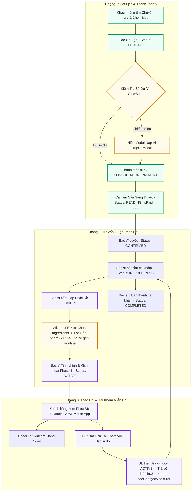

# 🗺️ QUY TRÌNH TƯ VẤN, VÍ THANH TOÁN & PHÁC ĐỒ ĐIỀU TRỊ (MASTER INTEGRATION & PLANNING SPEC)

Tài liệu này là **Kế Hoạch & Thông Số Kỹ Thuật Master** dành cho cả **Team Dev Backend (BE)** và **Team Dev Frontend (FE)** nhằm tích hợp luồng **Đặt Lịch Khám ➔ Thanh Toán Ví ➔ Tư Vấn ➔ Lập Phác Đồ ➔ Sinh Routine qua Rule-Engine ➔ Tái Khám Miễn Phí (0đ)**.

---

## 1. 📊 Sơ Đồ Luồng Tổng Thể (Master Sequence Diagram)



---

## 2. ⚡ 4 Quy Tắc Nghiệp Vụ Bắt Buộc Chuẩn Hóa Với BE (Business Rules & Gates)

### 🔴 Quy Tắc 1: Ràng Buộc Thanh Toán Qua Ví & Trạng Thái Booking (`Wallet Gate & Status Machine`)

- **Booking Status Machine chuẩn:** CHỈ GỒM 5 TRẠNG THÁI: `PENDING` ➔ `CONFIRMED` ➔ `IN_PROGRESS` ➔ `COMPLETED` | `CANCELLED`. **Không có trạng thái `PAID`**.
- **Lưu vết thanh toán:** Quản lý qua cờ `isPaid: boolean` và `feeChargedVnd`. Sau khi gọi `POST /bookings/:id/pay`, ca hẹn giữ nguyên trạng thái `PENDING` kèm `isPaid = true`.
- **Ràng buộc Confirm:** Bác sĩ chỉ được phép bấm `CONFIRMED` (`PATCH /bookings/:id/confirm`) khi ca hẹn có `isPaid === true` hoặc `isFollowUp === true`. Nếu chưa trả ví, nút bấm bị khóa kèm tooltip _"Chờ bệnh nhân thanh toán ví"_.

### 🟢 Quy Tắc 2: Tái Khám Miễn Phí (`Free Re-booking Gate`)

- Khi Khách hàng đặt lịch tái khám trong thời gian Phác đồ `ACTIVE` với Bác sĩ đó:
  - Backend tự động trả về `isFollowUp = true` và `feeChargedVnd = 0`.
  - Frontend hiển thị Badge **"🟢 TÁI KHÁM MIỄN PHÍ 0Đ"** dựa trực tiếp trên cờ `isFollowUp = true` từ Backend.

### 🟡 Quy Tắc 3: Hoàn Tiền Ví Khi Hủy Ca (`Wallet Refund Rule`)

- Khi Hủy ca hẹn ở trạng thái `PENDING` hoặc `CONFIRMED` đã thanh toán (`isPaid === true`):
  - Backend tự động **hoàn tiền vào Ví** (`REFUND`).
  - Frontend tự động invalidate cache `["wallet"]` để cập nhật ngay số dư mới.
- Ca hẹn ở trạng thái `IN_PROGRESS` KHÔNG được phép hủy (Backend trả lỗi `HTTP 400`).

### 🟣 Quy Tắc 4: Rule-Engine Sinh Routine & Chỉnh Sửa Phác Đồ

- Khi Bác sĩ gọi `POST /treatments`, BE dùng **Rule-Engine** lọc danh sách Sản phẩm dựa theo `targetIngredients` do Bác sĩ chỉ định, sau đó tự động phân bổ thành các bước Skincare Sáng/Tối (`amSteps`, `pmSteps`).

---

## 3. 📋 DANH SÁCH API ENDPOINTS CHUẨN BACKEND

### 3.1 Nhóm API Ví Thanh Toán (`Wallet Controller`)

| Method | Endpoint                  | Auth     | Yêu Cầu Xử Lý BE                                                     | Response Body                                                           |
| ------ | ------------------------- | -------- | -------------------------------------------------------------------- | ----------------------------------------------------------------------- |
| `GET`  | `/wallet/me`              | Customer | Lấy số dư ví khách hàng hiện tại                                     | `{ id: string, userId: string, balanceVnd: number, isActive: boolean }` |
| `POST` | `/bookings/:id/pay`       | Customer | Trừ tiền ví cho ca hẹn (Chuyển `isPaid: true`, giữ status `PENDING`) | `{ id: string, balanceVnd: number, isPaid: true }`                      |
| `POST` | `/wallet/top-up`          | Customer | Nạp tiền vào ví                                                      | `{ id: string, balanceVnd: number }`                                    |
| `GET`  | `/wallet/me/transactions` | Customer | Lấy danh sách lịch sử giao dịch ví                                   | Array of `Transaction`                                                  |

### 3.2 Nhóm API Phác Đồ Điều Trị (`Treatments Controller`)

| Method  | Endpoint                                 | Auth              | Yêu Cầu Xử Lý BE                                            | Response Body                      |
| ------- | ---------------------------------------- | ----------------- | ----------------------------------------------------------- | ---------------------------------- |
| `GET`   | `/treatments`                            | Customer / Expert | Lấy danh sách phác đồ da (Filter: `customerId`, `expertId`) | Array of `TreatmentPlan`           |
| `GET`   | `/treatments/:id`                        | Auth              | Chi tiết 1 phác đồ                                          | Object `TreatmentPlan`             |
| `POST`  | `/treatments`                            | Expert            | Bác sĩ lập phác đồ mới cho bệnh nhân                        | Object `TreatmentPlan` mới         |
| `PATCH` | `/treatments/:id/phases/:phaseId/active` | Expert            | Chuyển đổi / Kích hoạt Phase điều trị                       | Object `TreatmentPlan` đã cập nhật |

---

## 4. 🗄️ CẤU TRÚC JSON `ConsultationBooking` MẪU CHUẨN FE

```json
{
  "id": "bk_123456",
  "customerId": "user_customer_demo",
  "customerName": "normal111",
  "expertId": "seed-expert-d1-derma",
  "expertName": "Dr. Nguyen Van An",
  "symptoms": "Mụn sưng viêm vùng má",
  "status": "PENDING",
  "isPaid": true,
  "isFollowUp": false,
  "feeChargedVnd": 200000,
  "scheduledAt": "2026-07-28T09:00:00.000Z",
  "createdAt": "2026-07-27T15:00:00.000Z"
}
```

---

## 🛡️ 5. KHÁC PHỤC LỖI ĐIỀU HƯỚNG `/login`

- Các trang protected (như `/profile`, `/checkout`) không gọi `router.replace("/login")` trực tiếp trong render phase.
- Hiển thị màn hình thông báo chưa đăng nhập trực quan kèm nút chuyển hướng chủ động để không làm hỏng lịch sử trình duyệt khi bấm nút **Back**.
