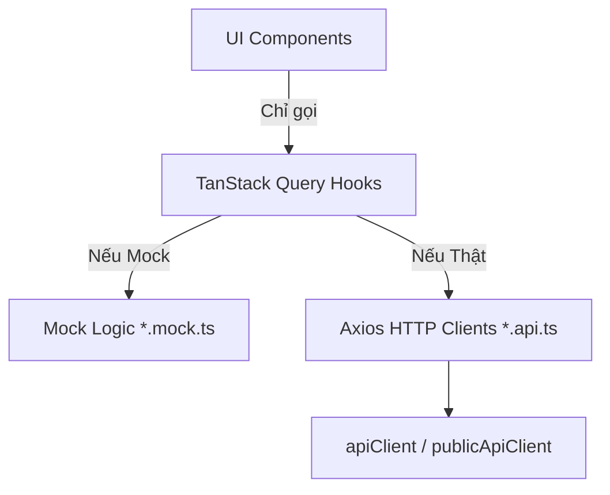

# Hướng dẫn Phát triển & Quy chuẩn Dự án (Frontend Developer Guide)

Tài liệu này định nghĩa cấu trúc thư mục, quy chuẩn viết code (coding convention), luồng xử lý dữ liệu và quy trình làm việc trong dự án nhằm đảm bảo mã nguồn luôn sạch sẽ, dễ theo dõi (tracking) và bảo trì khi phát triển nhóm.

---

## 1. Cấu trúc Thư mục Dự án (`src/`)

Thư mục `src` được chia làm các khu vực có trách nhiệm rõ ràng, tuân thủ nguyên tắc **phụ thuộc một chiều (One-Way Dependency)**:

```text
src/
├── app/                  # Routing Layer (Next.js App Router)
├── core/                 # Infrastructure dùng chung cho toàn dự án
│   ├── api/              # Axios clients, error handling, token refresh
│   └── config/           # Cấu hình môi trường (env)
├── features/             # Business Logic Layer (Tổ chức theo tính năng)
│   ├── auth/
│   ├── booking/
│   ├── commerce/
│   ├── experts/
│   └── profile/
├── shared/               # UI Components & Utilities dùng chung (không có business logic)
│   ├── components/       # Buttons, Input, Modal, UI Kit (Shadcn)
│   └── utils/            # Formatters, helpers thô
├── types/                # Domain models toàn cục và kiểu dữ liệu dùng chung
└── config/               # Cấu hình tĩnh của ứng dụng (siteConfig, menus)
```

### Chi tiết vai trò từng thư mục:

#### 1.1. `src/core/` (Hạ tầng lõi)

- **Trách nhiệm**: Chứa các cấu hình cơ sở hạ tầng dùng chung cho toàn bộ ứng dụng (ví dụ: HTTP client, cơ chế refresh token, chuẩn hóa lỗi API, upload file).
- **Quy tắc**:
  - Không chứa logic nghiệp vụ đặc thù của bất kỳ tính năng (feature) nào.
  - **Không được phép phụ thuộc ngược** vào thư mục `src/features/`.
  - Hỗ trợ cơ chế đăng ký sự kiện (`auth-handlers.ts`) để tầng ngoài (như `app-providers.tsx`) truyền logic nghiệp vụ vào mà không gây phụ thuộc ngược.

#### 1.2. `src/features/` (Tính năng nghiệp vụ)

Dự án được chia theo kiến trúc **Feature-Based**. Mỗi thư mục con đại diện cho một phân hệ nghiệp vụ độc lập (ví dụ: `auth`, `booking`, `commerce`). Mỗi phân hệ gồm:

- **`api/`**:
  - `<feature>.api.ts`: **Chỉ chứa các khai báo gọi HTTP Axios thô** kết nối trực tiếp đến backend. Không chứa logic điều phối, không phân nhánh mock, trả về trực tiếp `AxiosResponse`.
  - `<feature>.mock.ts`: Chứa dữ liệu giả lập và mock database (nếu chạy ở chế độ offline/mock).
- **`hooks/`**:
  - Các hooks TanStack Query đặt tên dạng `use[FeatureName].ts` (ví dụ: `useCart.ts`, `useBooking.ts`).
  - **Đây là nơi chịu trách nhiệm chính về mặt nghiệp vụ**: Phân nhánh Mock/Real, thực hiện chuyển đổi dữ liệu (Mapping) từ Backend DTO sang Domain Model và xử lý side-effects.
- **`types/`**: Chứa kiểu dữ liệu cụ thể phục vụ riêng cho phân hệ (ví dụ: Request DTOs, Form types).
- **`components/`**: Các UI components chỉ phục vụ riêng cho tính năng này.
- **`pages/`**: Các trang giao diện chính của tính năng.

#### 1.3. `src/shared/` (Tái sử dụng phi nghiệp vụ)

- Chỉ chứa các thành phần dùng chung không gắn liền với bất kỳ logic kinh doanh nào (ví dụ: Button, Dialog, Spinner, hàm format tiền tệ `formatVnd`).

#### 1.4. `src/app/` (Routing và Layouts)

- Next.js App Router chịu trách nhiệm routing.
- Các tệp `page.tsx` trong `app/` chỉ nên đóng vai trò là "điểm nối", import các UI component lớn từ `features/` hoặc `shared/` để render, tránh viết logic render JSX dài trực tiếp tại đây.

---

## 2. Quy chuẩn Thiết kế API & Server State (React Query)

Để tránh viết code hỗn loạn (vừa gọi API, vừa xử lý logic, vừa lưu storage trong cùng một file), dự án áp dụng mô hình **3 lớp nghiêm ngặt**:



### Quy tắc triển khai:

1. **Không gọi API trực tiếp từ UI Component**: Tất cả các thành phần UI chỉ được tương tác với Server State thông qua các **TanStack Query Hooks** chuyên biệt (`useQuery`, `useMutation`).
2. **File `<feature>.api.ts` phải hoàn toàn "ngu ngốc" (Dumb HTTP Wrapper)**:
   - Chỉ import `apiClient` hoặc `publicApiClient` từ `@/core/api/client` và `API_ENDPOINTS` từ `@/core/api/endpoints`.
   - Trả về trực tiếp `AxiosResponse`.
   - _Ví dụ mẫu chuẩn:_
     ```typescript
     // src/features/commerce/api/cart.api.ts
     export const cartApi = {
       getCart: (): Promise<AxiosResponse<CartResponse>> => {
         return apiClient.get<CartResponse>(API_ENDPOINTS.CART.GET);
       },
       addToCart: (
         productVariantId: string,
         quantity: number,
       ): Promise<AxiosResponse<CartResponse>> => {
         return apiClient.post<CartResponse>(API_ENDPOINTS.CART.ITEMS, {
           productVariantId,
           quantity,
         });
       },
     };
     ```

3. **Quy chuẩn triển khai Hook (TanStack Query Hooks)**:
   - **Trường hợp A: API có phân nhánh Mock/Real hoặc cần Mapping dữ liệu phức tạp (ví dụ: Booking, Auth, Profile)**:
     - **BẮT BUỘC viết tường minh khối `async/await` trong `queryFn`** để phân nhánh kiểm tra `appConfig.useMockApi` và gọi hàm mapper chuyển đổi từ Backend DTO sang Frontend Domain Model.
     - _Ví dụ mẫu chuẩn:_

       ```typescript
       // src/features/booking/hooks/useBooking.ts
       import { useQuery } from "@tanstack/react-query";
       import { bookingApi } from "../api/booking.api";
       import { bookingMock } from "../api/booking.mock";
       import { mapBackendBookingToFrontend } from "../mapper/booking-mapper";
       import type { ConsultationBooking } from "../types/booking.types";

       type UseBookingsOptions = {
         initialData?: ConsultationBooking[];
         staleTime?: number;
       };

       export const useBookings = (options: UseBookingsOptions = {}) => {
         return useQuery({
           queryKey: queryKeys.bookings,
           queryFn: async () => {
             if (appConfig.useMockApi) {
               return bookingMock.getBookings(); // Gọi mock file
             }
             const response = await bookingApi.getBookings(); // Gọi api file
             return response.data.items.map(mapBackendBookingToFrontend); // Thực hiện mapping
           },
           initialData: options.initialData,
           staleTime: options.staleTime,
         });
       };
       ```

   - **Trường hợp B: API chạy thật 100% (Không có Mock) & Không cần mapping phức tạp (ví dụ: Products, Categories, Provinces)**:
     - **KHUYÊN DÙNG sử dụng cú pháp rút gọn `.then(res => res.data)`** để giải nén dữ liệu trực tiếp từ AxiosResponse mà không cần viết khối `async/await` dư thừa.
     - _Ví dụ mẫu chuẩn:_

       ```typescript
       // src/features/commerce/hooks/useProducts.ts
       import { useQuery } from "@tanstack/react-query";
       import { productsApi } from "../api/products.api";
       import type { ProductDetail } from "../types/product.types";

       type UseProductOptions = {
         enabled?: boolean;
         staleTime?: number;
       };

       export const useProduct = (
         id: string,
         options: UseProductOptions = {},
       ) => {
         return useQuery({
           queryKey: queryKeys.product(id),
           // Gọi trực tiếp và unwrap dữ liệu cực kỳ ngắn gọn
           queryFn: () =>
             productsApi.getProductById(id).then((res) => res.data),
           enabled: !!id && options.enabled,
           staleTime: options.staleTime,
         });
       };
       ```

---

## 3. Quy chuẩn viết code (Coding Conventions)

### 3.1. Đặt tên (Naming Conventions)

- **Thư mục & Tệp UI**: Sử dụng `kebab-case` toàn bộ (ví dụ: `cart-item-row.tsx`, `checkout-page.tsx`).
- **Tệp Custom Hook**: Sử dụng `camelCase` bắt đầu bằng `use` (ví dụ: `useCart.ts`, `useBookingDetail.ts`).
- **Hằng số**: Sử dụng `UPPER_SNAKE_CASE` (ví dụ: `API_TIMEOUT`, `LOCAL_STORAGE_KEY`).
- **Kiểu dữ liệu (TypeScript)**:
  - Kiểu đại diện cho Model: PascalCase (`Product`, `UserProfile`).
  - Kiểu đại diện cho Data Transfer Object từ Backend: Có hậu tố `Dto` hoặc `Response`/`Request` (ví dụ: `ProductResponseDto`, `CreateOrderRequest`).

### 3.2. TypeScript & Chất lượng mã nguồn

- **Nghiêm cấm sử dụng `any`**: Sử dụng `unknown` nếu không rõ kiểu dữ liệu ban đầu, hoặc bắt buộc phải định nghĩa interface/type cụ thể.
- **Hạn chế ép kiểu tùy tiện (`as`)**:
  - Chỉ dùng `as` khi chắc chắn dữ liệu khớp (như mapping từ string sang string union enum).
  - Ưu tiên sử dụng Type Guards (`if (typeof x === "string")`) hoặc Schema Validation (Zod).
- **Optional Chaining & Nullish Coalescing**:
  - Sử dụng `?.` và `??` thay thế cho việc kiểm tra lồng nhau lỗi thời `&&`.

---

## 4. Quản lý Trạng thái (State Management)

- **Server State**: Bắt buộc dùng **TanStack Query** (React Query). Quản lý tập trung các khóa cache tại `src/lib/query/keys.ts`.
- **Global UI State**: Chỉ dùng **Zustand** khi cần truyền trạng thái UI qua nhiều cấp components xa nhau mà không cần lưu trữ trên server (ví dụ: trạng thái mở Sidebar, giỏ hàng tạm của khách vãng lai).
- **Local State**: Sử dụng `useState` và `useContext` của React cho các phạm vi component hẹp.

---

## 5. Quy trình làm việc với Git (Conventional Commits)

Tất cả các thành viên trong nhóm phải tuân thủ nghiêm ngặt định dạng thông điệp commit (Git Commit Message) Conventional Commits để dễ dàng theo dõi lịch sử:

```text
<type>(<scope>): <description>

[body]
```

### Các tiền tố (`type`) bắt buộc:

- `feat`: Thêm một tính năng mới.
- `fix`: Sửa lỗi (bug fix).
- `refactor`: Tái cấu trúc mã nguồn (không sửa lỗi, không thêm tính năng).
- `style`: Thay đổi định dạng code (khoảng trắng, format, thiếu dấu phẩy - không ảnh hưởng logic).
- `docs`: Cập nhật tài liệu hướng dẫn (ví dụ: README, API docs).
- `chore`: Thay đổi quy trình build hoặc công cụ bổ trợ (cập nhật package, cấu hình lint).
- `test`: Thêm hoặc sửa mã nguồn kiểm thử.

_Ví dụ commit chuẩn:_

- `feat(cart): tích hợp API cập nhật số lượng sản phẩm`
- `fix(auth): xử lý lỗi crash giao diện khi token hết hạn đột ngột`
- `refactor(booking): tách logic mock database ra khỏi booking.api.ts`
